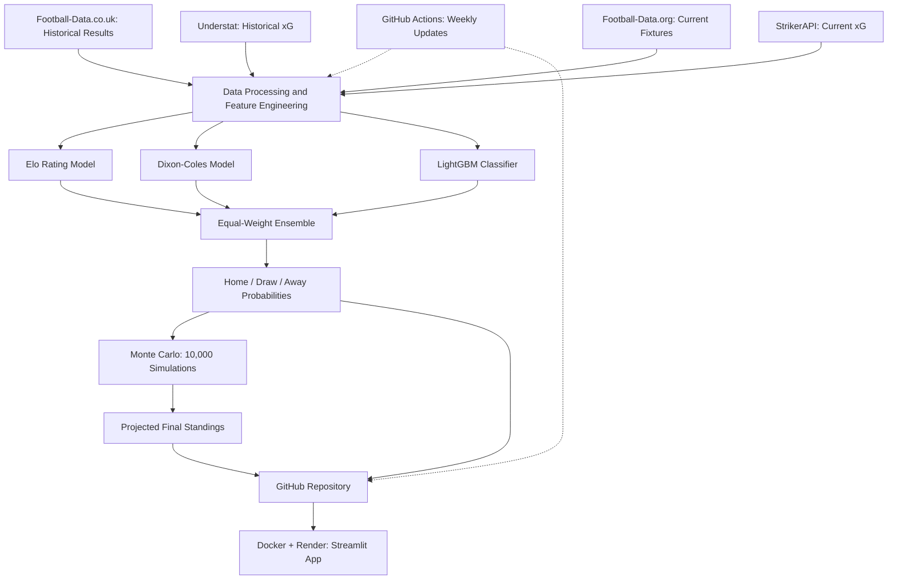

# ⚽ EPL Forecast Engine

A Dockerized, end-to-end machine learning application for predicting English Premier League match outcomes and simulating final league standings.

The project combines **Elo ratings, Dixon–Coles statistical modeling, and LightGBM** into an equal-weight ensemble that generates home-win, draw, and away-win probabilities.

It also uses **10,000 Monte Carlo simulations** to estimate final league positions, expected points, title probabilities, top-four finishes, and relegation risks.

**[🚀 Live Application](https://epl-forecast-engine.onrender.com/)**

## Features

- **Live Premier League Standings:** Current league table calculated from completed 2026–27 fixtures.
- **Match Predictions:** Home-win, draw, and away-win probabilities for upcoming matches.
- **Season Simulation:** Projected final standings generated from 10,000 Monte Carlo simulations.
- **Team-Level Projections:** Expected points, finishing position, title probability, top-four probability, and relegation risk.
- **Historical Model Evaluation:** Accuracy, log loss, and multiclass Brier score, compared against normalized Bet365 implied probabilities.
- **Automated Updates:** A GitHub Actions workflow refreshes fixtures, model predictions, and simulations every Tuesday.
- **Containerized Deployment:** Docker-based Streamlit application hosted on Render.

## Machine Learning Architecture

The prediction engine combines three complementary modeling approaches.

### 1. Elo Rating Model

A dynamic team-strength rating system that accounts for:

- Historical match results
- Opponent strength
- Home advantage
- Goal difference
- Regression toward the starting rating between seasons

The Elo ratings are used both as LightGBM input features and as the basis for an independent probabilistic prediction model.

### 2. Dixon–Coles Model

A statistical football model that estimates team attacking strength, defensive strength, and home advantage.

The model uses Poisson goal distributions and a Dixon–Coles correction for low-scoring results, allowing it to estimate expected goals and match outcome probabilities.

Parameters are fitted by minimizing a regularized negative log-likelihood.

### 3. LightGBM Classifier

A gradient-boosted decision tree classifier trained on 13 engineered features, including:

- Rolling five-match points
- Goals scored and conceded
- Expected goals (xG) and expected goals against (xGA)
- Home and away Elo ratings
- Elo rating difference

Historical evaluation uses chronological, season-based training and testing splits.

### Ensemble Prediction

The three models contribute equally to the final prediction:

$$
P_{\text{ensemble}} = \frac{P_{\text{Elo}} + P_{\text{DC}} + P_{\text{LightGBM}}}{3}
$$

The resulting probabilities are used for individual match predictions and season simulations.

## Monte Carlo Season Simulation

The simulation engine generates 10,000 possible outcomes for every remaining Premier League fixture.

Dixon–Coles produces scoreline distributions, which are adjusted to match the ensemble's home-win, draw, and away-win probabilities.

Each simulated season incorporates:

1. Actual results from completed fixtures.
2. Randomly generated scorelines for remaining fixtures.
3. League points, goals scored, goals conceded, and goal difference.
4. Final league standings and finishing positions.

Aggregating 10,000 simulated seasons provides estimates for expected points, expected positions, title probabilities, top-four probabilities, and relegation risks.

## Historical Model Evaluation

The prediction models are evaluated on historical Premier League matches from 2021–22 through 2025–26.

The ensemble is compared against Bet365 implied probabilities after normalizing bookmaker odds to remove the proportional overround.

| Evaluation period | Model | Accuracy | Log Loss |
|---|---|---:|---:|
| 2021–22 to 2024–25 | Ensemble | 54.75% | 0.9662 |
| 2021–22 to 2024–25 | Bet365 | 56.86% | 0.9466 |
| 2025–26 | Ensemble | 48.16% | 1.0298 |
| 2025–26 | Bet365 | 48.95% | 1.0185 |

These metrics are from the project's historical evaluation runs. The bookmaker baseline outperforms the ensemble over these periods.

The 2025–26 evaluation is reported separately, but should not be interpreted as a completely untouched holdout because model-development decisions were also informed by results from that season.

## Data Sources

**Football-Data.co.uk:** Historical Premier League results and Bet365 odds, covering the 2014–15 through 2025–26 seasons.

**Understat:** Historical match-level expected-goals data.

**Football-Data.org API:** Current-season fixtures, results, match status, and team information.

**StrikerAPI:** Current-season xG information and additional match-level shot data.

Historical and current-season xG sources differ. Current predictions initially use a frozen team-level xG baseline, switching to rolling five-match xG after sufficient new match observations have been collected.

## Technology Stack

| Category | Technologies |
|---|---|
| Language | Python 3.11 |
| Data Processing | Pandas, NumPy |
| Machine Learning | LightGBM, Scikit-learn |
| Statistical Modeling | SciPy, Poisson, Dixon–Coles |
| Web Application | Streamlit |
| Containerization | Docker |
| Automation | GitHub Actions |
| Deployment | Render |
| Version Control | Git, GitHub |

## Running Locally

Clone the repository:

```bash
git clone https://github.com/NikosT23/epl-forecast-engine.git
cd epl-forecast-engine
```

Create and activate a Python virtual environment, then install the project:

```bash
python -m venv .venv
```

Windows:

```powershell
.venv\Scripts\Activate.ps1
```

macOS/Linux:

```bash
source .venv/bin/activate
```

Install dependencies:

```bash
pip install -e .
```

Launch Streamlit:

```bash
python -m streamlit run src/epl_predictor/app.py
```

Open `http://localhost:8501`.

## Running with Docker

Build the Docker image:

```bash
docker build -t epl-forecast-engine .
```

Start the application:

```bash
docker run --rm -p 8501:8501 epl-forecast-engine
```

Visit `http://localhost:8501` in your browser.

The Docker image includes the datasets needed to display the application. API credentials are not required simply to view the existing predictions.

## Automated Data Pipeline

The project uses GitHub Actions for automated weekly updates.

**Schedule:** Every Tuesday at 10:30 AM, Europe/Athens.

The refresh pipeline:

1. Downloads updated Premier League fixtures and results.
2. Collects missing match-level xG.
3. Recalculates rolling performance features and Elo ratings.
4. Retrains the prediction models as configured.
5. Generates updated match probabilities.
6. Runs 10,000 season simulations.
7. Saves generated datasets to the GitHub repository.

The workflow can also be triggered manually.

API credentials are stored in GitHub Actions Secrets, not in the source code.

Render is configured to deploy automatically when changes are pushed to the repository's `main` branch.

## Model Limitations

- Match predictions represent estimated probabilities, not guaranteed outcomes.
- The ensemble assigns equal weights to all three models.
- Current-season xG uses a different provider from historical training xG.
- Season simulations use fixed fixture probabilities rather than dynamically updating predictions after simulated matches.
- Projected league standings approximate certain official tie-breaking rules.
- Historical performance is not evidence of guaranteed future prediction accuracy.

## Future Improvements

Potential extensions include:

- Probability calibration and reliability analysis
- Comparing optimized ensemble weights against equal weighting
- Incorporating additional injury or squad information
- Monitoring model drift and performance throughout the season
- Improving cross-provider consistency for expected-goals data
- Extending automated data-quality checks

---

## System Architecture

## System Architecture




**Live application:** https://epl-forecast-engine.onrender.com/

**Repository:** https://github.com/NikosT23/epl-forecast-engine
